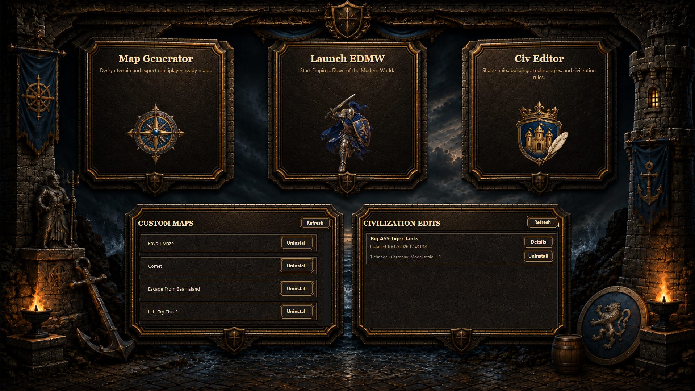
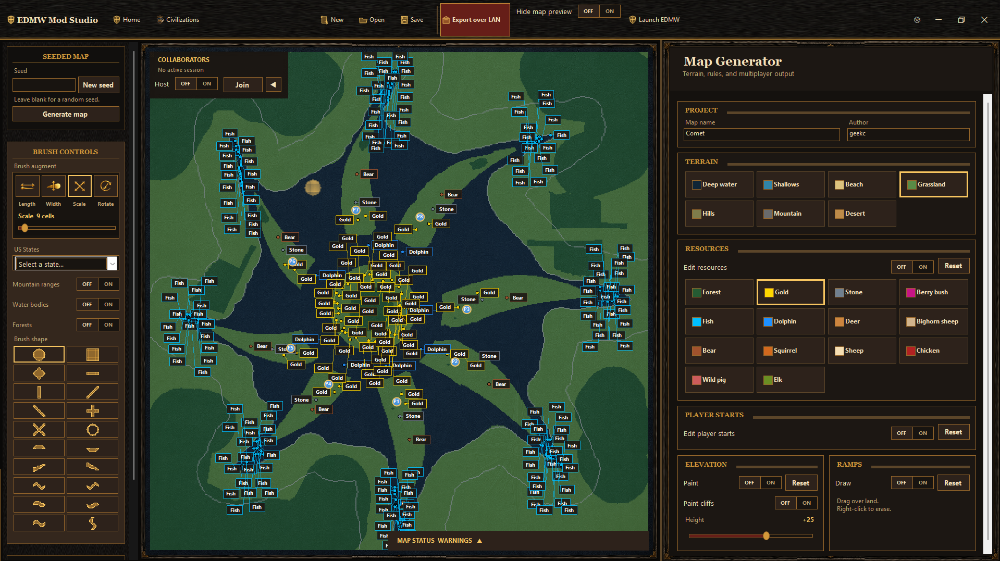
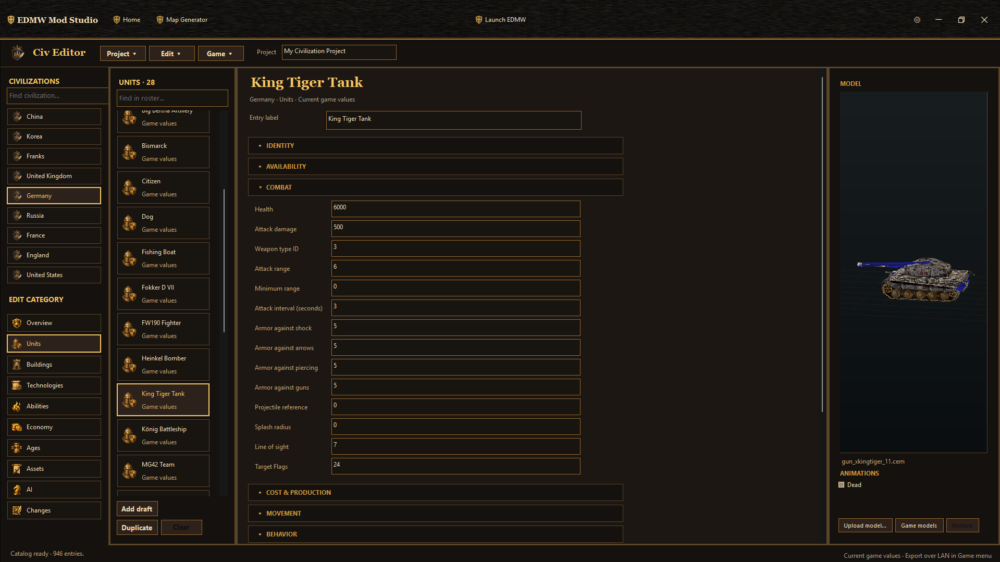

# EDMW Mod Studio

**EDMW Mod Studio** is a Windows modding workspace for **Empires: Dawn of the Modern World**. It combines a visual Map Designer, a Civilization Editor, and tracked installation and sharing over LAN or online with friends.

The application is version **1.0.0**. It is built with C#/.NET Windows Forms and includes a native, 32-bit map generator for the game.

**[Download v1.0.0 for Windows](https://github.com/jfh24/EDMW-Mod-Studio/releases/download/v1.0.0/EDMW.Mod.Studio.exe)** · [Release notes and assets](https://github.com/jfh24/EDMW-Mod-Studio/releases/tag/v1.0.0)

The source repository does not include the compiled executable. Download it from the release or build it locally using the instructions below.

## Features

- **Map design:** paint terrain, elevation, cliffs, ramps, forests, resources, wildlife, fish, and player starts for lobby slots 1–8.
- **Brushes:** twenty standard shapes and all 50 US state silhouettes, with length, width, scale, rotation, and optional mapped mountain, water, and forest layers.
- **Generation:** create random land or repeatable terrain layouts from a saved seed.
- **Editable projects:** save maps as `.edmwmap` and civilization projects as `.edmwciv`, with independent undo/redo histories.
- **Civilization editing:** browse the nine stock civilizations and their units, buildings, technologies, abilities, economy, ages, assets, and AI source data; author supported native overrides.
- **Model previews:** inspect installed models, textures, player colors, and animation clips; embed replacement `.cem` or `.obj` assets in civilization projects.
- **LAN collaboration:** host or join a shared map with synchronized paint strokes and named live cursors.
- **LAN export:** install an export on the sender and offer it to other running instances for recipient approval.
- **Online friends:** exchange friend codes, accept requests, and see online presence through a Node.js relay.
- **Online collaboration and export:** invite accepted friends to edit maps, or send map and civilization exports for recipient approval. Includes a Render deployment blueprint.
- **Installed content:** review and uninstall tracked maps and civilization packages from Home.

See the [user guide](docs/user-guide.md) for controls and detailed workflows.

## Screenshots

**Home:** open a workspace and manage installed maps and civilization edits.



**Map Designer:** paint terrain, shape elevation, and place resources and player starts.



**Civilization Editor:** browse game data and author supported civilization changes.



## Run the application

On 64-bit Windows 10 or later, download and run [EDMW.Mod.Studio.exe](https://github.com/jfh24/EDMW-Mod-Studio/releases/download/v1.0.0/EDMW.Mod.Studio.exe). You can keep that filename or rename it to `EDMW Mod Studio.exe`.

If you build from source, open:

```text
dist\EDMW Mod Studio.exe
```

The published executable is self-contained; the .NET SDK is needed only to build from source. Generated executables are distributed as release assets rather than committed to the source repository. See [dist/README.md](dist/README.md) for the output folder details.

1. Open **Settings** from the top-right toolbar and select the game folder containing `Empires_DMW.exe`.
2. Choose **Map Designer** or **Civ Editor** from Home.
3. Create your changes and save the editable project.
4. Choose **Export over LAN** in the active workspace to install locally and offer the same export to discovered recipients.
5. Use Home to inspect or uninstall installed content.

A valid, separately installed copy of the game is required for game data, model assets, and exports. Game executables, original game DLLs, databases, and asset archives are not provided by this repository.

## Build from source

Requirements:

- Windows 10 or later, 64-bit.
- .NET SDK **9.0 or newer**. The projects target `net9.0-windows`; `global.json` permits newer SDKs through roll-forward.
- Visual Studio or Visual Studio Build Tools with the **Desktop development with C++** components, including MSVC x86/x64 tools and a Windows SDK.
- PowerShell and Git.
- Network access for the initial .NET restore when required dependencies are not cached.

From PowerShell:

```powershell
git clone https://github.com/jfh24/EDMW-Mod-Studio.git
Set-Location EDMW-Mod-Studio
.\build.ps1
```

The build script finds the Visual Studio C++ tools, compiles and checks the x86 native generator, publishes both installer templates, embeds them in the application, and publishes a self-contained `win-x64` executable:

```text
dist\EDMW Mod Studio.exe
```

The native DLL is x86 because it is loaded by the 32-bit game; the editor and installer applications are published for x64 Windows. Build outputs and staging files are ignored by Git. A direct build of the editor requires the generated native DLL and installer resources, so use `build.ps1` for a clean checkout.

See [development and verification](docs/development.md) for build details, existing checks, and optional tooling.

## Online sharing in source builds

The online features are available in source builds after the v1.0.0 release linked above. Open **Friends**, enter the relay's `https://<service-name>.onrender.com` URL and your display name, and choose **Connect**. Exchange friend codes and accept a request before inviting a friend into a shared map or choosing **Export to friends**. Both users must connect to the same relay and run matching application builds. LAN features remain available independently.

The relay uses HTTPS/WSS, authenticates device identities, and checks accepted friendships for invitations and exports. The app protects its local credential with Windows DPAPI. Export recipients review and approve installation through the existing package validation and installation system.

Deploy the included Node.js service using [render.yaml](render.yaml). A persistent disk retains identities and friendships across deployments; shared map sessions and pending offers end on disconnect or relay restart. See [online sharing and Render setup](docs/online-sharing.md) for local setup, deployment, operational limits, and verification.

## LAN behavior

Each recipient must run the same version of EDMW Mod Studio with receiving enabled. Export discovery operates independently of a collaboration session.

| Feature | TCP default | UDP discovery | How it is enabled |
| --- | ---: | ---: | --- |
| Shared map editing | 42817 | 42818 | **Collaborate > Host/Join** |
| Civilization export | 42819 | 42820 | **Settings > Receive civ edits over LAN** |
| Map export | 42821 | 42822 | **Settings > Receive maps over LAN** |

Map and civilization transfer TCP ports are configurable in Settings. Allow the relevant application and ports through the firewall on the LAN.

The protocols use IPv4 TCP/UDP and are intended for trusted local networks. They do not encrypt traffic or authenticate peer identities. Package hashes and local validation check integrity and supported content; they do not establish who sent an offer. Recipients must choose **Accept** before installation. Denying an offer leaves game files unchanged. The sender installs its own export even when no peers are found.

Shared editing applies completed strokes in host order; the latest completed change takes precedence on overlapping cells. **Hide map preview** redacts the exported preview while preserving map identity.

## Project and package formats

| Format | Purpose |
| --- | --- |
| `.edmwmap` | Editable map project, including terrain, authored markers, elevation, cliffs, ramps, and generation metadata. |
| `.edmwciv` | Editable civilization project with overrides and embedded replacement model bytes. |
| `.rmv` | Game random-map script generated as part of map installation. |
| `.edmwa` | Native terrain/marker sidecar used by the custom map generator. |
| `.cem` | Native model format supported for preview and verified model replacement. |
| `.obj` | Model import/preview format; native conversion is required before game installation. |

Map installation adds a generated script, sidecar, and map-specific generator DLL without replacing original game maps or DLLs. Civilization installation patches supported database fields and model targets through reviewed packages, with backups, ownership tracking, recovery, and uninstall.

## Current scope and limitations

- Terrain seeds reproduce editor terrain for the same seed and grid size. Stock game resource randomness and other game-side variation are separate.
- US state brushes and geography layers are generalized templates; small features can disappear at small brush scales.
- Only mapped, verified civilization edits can be installed. Unsupported changes block export.
- New civilization/definition insertion, unmapped rules, and native power parameters remain incomplete.
- Civilizations expose source data as well as editable fields. Read-only source values are not all installation targets.
- `.obj` replacements can be saved and previewed but need conversion to the native model format for installation.
- Civilization installation currently checks a specific supported game executable and source identities. See [compatibility details](docs/development.md#game-compatibility).
- Multiplayer participants need matching installed gameplay data.
- Automated and offline checks do not establish complete in-game or multiplayer validation. The wildlife implementation report records the available evidence and its remaining visual confirmation.

## Repository structure

```text
EDMWMapDesigner/              Main application; legacy source directory/namespace
  Analysis/                  Topology and semantic map analysis
  Models/                    Editable map model and markers
  Generation/                Terrain generation, RMV/payload export, map LAN packages
  Civilizations/             Game catalog, native bindings, models, package installation
  Collaboration/             Shared map editing protocol
  Networking/                LAN transport, online relay client, protected identity
  UI/                        Windows Forms views, canvas, previews, existing verifications
  Assets/                    UI art and retained geographic regeneration inputs
EDMWMultiplayerInstaller/    Embedded map installer template and standalone package UI
EDMWCivilizationInstaller/   Civilization installer template; shares package domain code
native/EDMWAnchored/         Production x86 map generator and resource-alignment checks
native/EDMWResourceSnapshot/ Optional diagnostic resource probe
native/EDMWStringProbe/      Optional diagnostic string probe
tools/                      Geography generators and native diagnostic tools
relay/                      Node.js friends, map collaboration, and export relay
render.yaml                 Single-instance Render service and persistent disk
docs/                       User guide, development notes, attribution, engineering report
build.ps1                   Complete production build
global.json                 SDK selection
dist/                       Output-folder README; generated executable is ignored
```

The public product name is **EDMW Mod Studio**. Existing source paths, namespaces, resource identifiers, and file formats retain `EDMWMapDesigner` where needed for compatibility.

## Documentation and credits

- [User guide](docs/user-guide.md)
- [Development, architecture, and verification](docs/development.md)
- [Online sharing and Render setup](docs/online-sharing.md)
- [Online relay protocol](docs/online-protocol.md)
- [Geographic data and artwork credits](docs/credits.md)
- [Manual wildlife and fish engineering report](docs/manual-wildlife-and-fish.md)

State boundaries, mountains, water, and forest layers retain their respective source notices and terms. In particular, derived GMBA and ESA WorldCover assets require attribution under CC BY 4.0. See [credits](docs/credits.md) and the source manifests under `EDMWMapDesigner/Assets/UsStateBrushes/`.

No general software license has been declared for this repository. The geographic datasets' terms apply to those assets separately.
